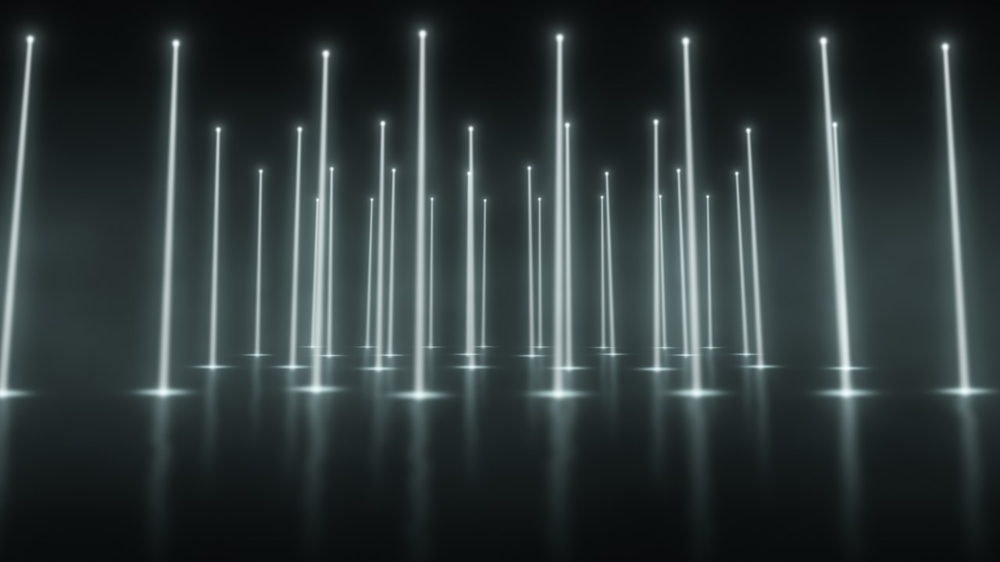

# Light Beams (FFGL source for Resolume)

A grid of ceiling lights shining straight down through haze, like a warehouse installation.
Each beam is drawn in 2D, then placed in rows with a simple perspective camera. It has floor hot
spots, glossy floor reflections and drifting smoke. Lights can run BPM-synced patterns or be
fired with trigger buttons that you can map to MIDI.

## Install

1. Get the build for your system:
   - From GitHub Actions: open the **Build Light Beams** workflow run, download `LightBeams-macOS`
     or `LightBeams-Windows`.
   - Or build it yourself: Xcode target `LightBeams` in `build/osx/FFGLPlugins.xcodeproj`, or
     `build/windows/LightBeams.vcxproj` in Visual Studio.
2. Copy `LightBeams.bundle` (Mac) or `LightBeams.dll` (Windows) to
   `Documents/Resolume Arena/Extra Effects` (on older versions: `Documents/Resolume/Extra Effects`).
3. On Mac, if the downloaded bundle is blocked, run `xattr -cr ~/Documents/Resolume\ Arena/Extra\ Effects/LightBeams.bundle`.
4. Restart Arena. It shows up under **Sources** as **Light Beams**.

## Playing it live

- **Pattern** picks what the lights do. **Rate** sets the step length (1/16 up to 4 bars), locked to
  Arena's BPM and bar position, so patterns start on the downbeat. Pick **Free (Hz)** to run on its
  own clock with **Free Rate Hz**.
- **Triggers** are buttons. Turn on MIDI mapping in Arena (Shortcuts > Edit MIDI), click a trigger,
  hit a pad, and turn mapping off again. They work in every pattern; use **Manual** if you want
  lights to fire only from your triggers.
- Every slider can also be MIDI/OSC mapped, or animated with Arena's BPM-synced
  dashboard/automation.
- **Resync** restarts the pattern from step one right now.

### Patterns

| Pattern | What it does |
|---|---|
| Static (all on) | Everything on at full level. |
| Chase | Columns light up left to right. **Chase Width** sets how many at once. |
| Row Chase | Whole rows, front to back. |
| Snake | One light at a time in a zig-zag through the grid. |
| Random | Each step lights a random share of the lights (**Density**). |
| Random Single | **Chase Width** random lights per step. |
| Alternate | Checkerboard that flips every step. |
| Strobe | Everything flashes every step. |
| Fill | Lights add up left to right until the grid is full, then it restarts. |
| Center Out | Columns ripple out from the middle. |
| Wave | A smooth brightness wave moves across (one cycle per 4 steps). |
| Manual (triggers only) | Nothing automatic. Only triggers fire lights. |

### Triggers

| Trigger | What it does |
|---|---|
| Flash All | Fires every light. |
| Flash Random | Fires a random share of the lights (**Density**). |
| Step | Advances the current pattern by one step. |
| Next Row / Next Column | Fires the next row or column, cycling through. |
| Resync | Restarts the pattern. |

### Envelope

- **Base Level**: brightness of lights that aren't firing (not used by Static).
- **Attack** / **Decay**: fade in and fade out time of a fired light, in seconds.
- **Drop Time**: when above 0, a fired beam grows down from the ceiling to the floor over this many
  seconds instead of appearing at once.

## Look

**Intensity**, **Hue**, **Saturation** (low saturation gives the cool white of the reference photo),
**Beam Width**, **Beam Spread** (beam widens towards the floor), **Glow** (soft halo), **Haze** and
**Haze Speed** (smoke texture in the beams), **Atmosphere** (room fog lit by the beams), **Floor Glow**,
**Reflection**, **Fixture Glow** (the lens at the top), **Depth Fade** (far rows dimmer),
**Background**, **Transparent BG** (outputs alpha so you can layer it on other clips; **Add** blend mode
also works well with the normal black background).

## Layout and camera

**Rows** (up to 10), **Columns** (up to 24), **Spacing X**, **Spacing Depth** (metres), **Row Stagger**
(shifts every other row by half a spacing), **Position Jitter**, **Angle Jitter** (slight random lean),
**Layout Seed** (new random layout), **Ceiling Height**, **Beam Length**.

**Cam Distance** (to the first row), **Cam Height**, **Cam Tilt** (degrees; tilting up makes the beams
converge like in a wide photo), **Cam FOV**, **Cam Pan X**.

## Notes

- Everything is drawn in a single full-screen shader pass, so cost grows with the number of lights.
  The default 4 × 8 grid is light; the maximum of 240 lights at 4K needs a decent GPU.
- Lights don't block each other; all light is added together, which is how beams in haze look anyway.
